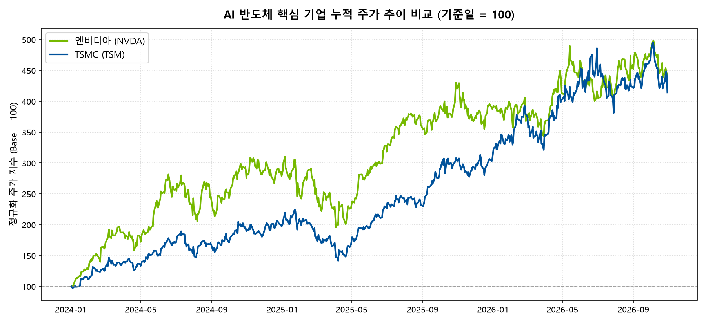
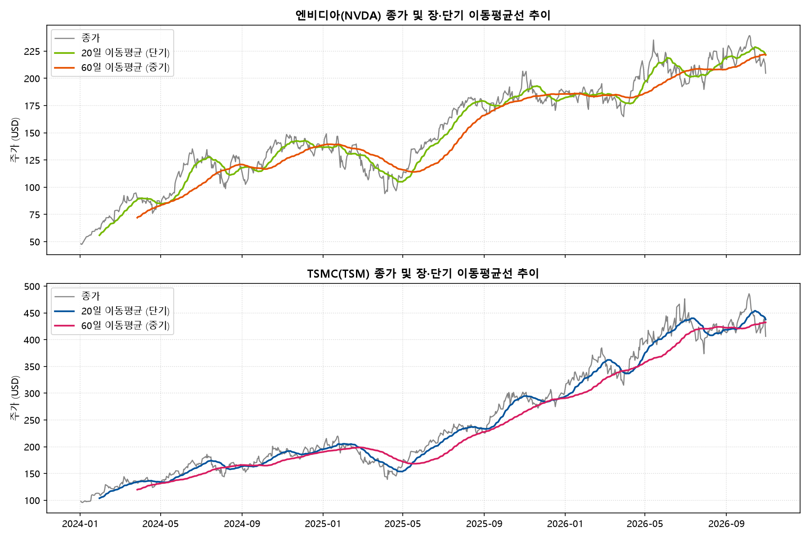
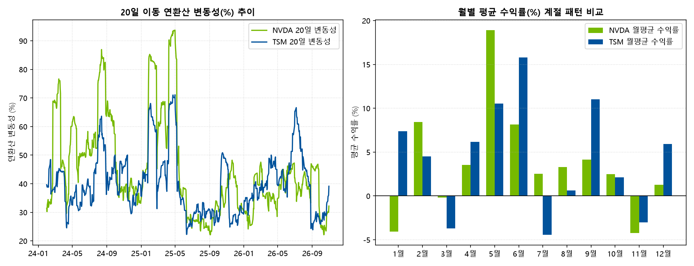
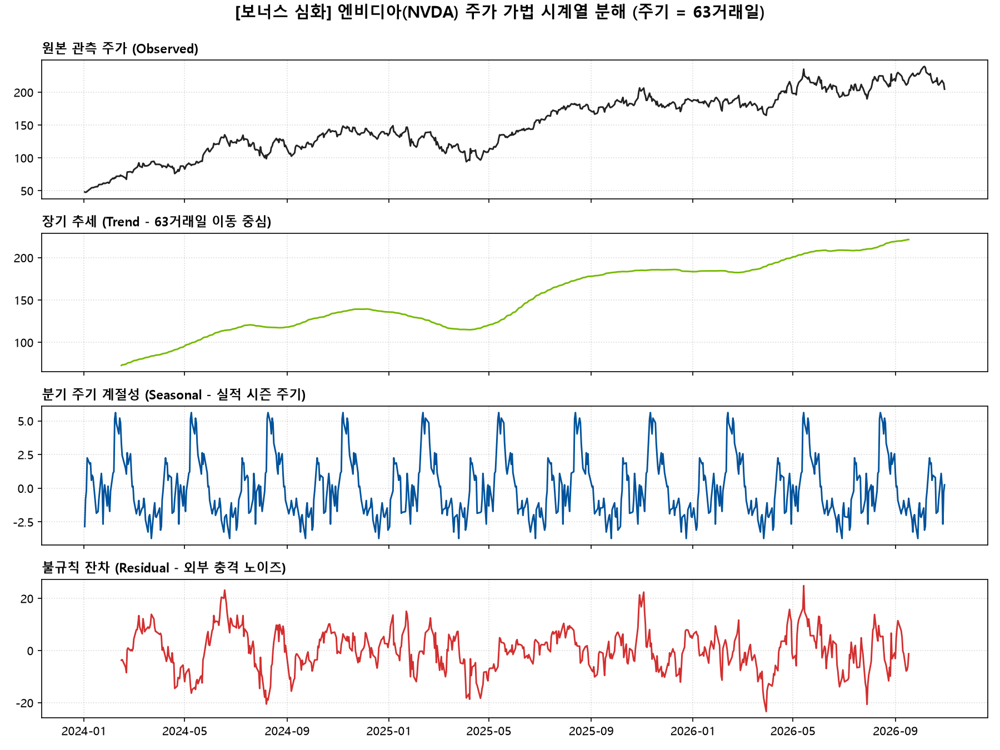

# AI 반도체 밸류체인 시계열 분석 리포트: 엔비디아(NVDA) vs TSMC(TSM)

## 1. 분석 주제 및 선정 이유
- **분석 주제:** AI 반도체 설계 1위 기업 엔비디아(NVDA)와 파운드리 독점 공급사 TSMC(TSM)의 주가 트렌드, 이동평균 추세, 변동성 및 계절성 비교 분석
- **선정 이유:** AI 인프라 투자 확대라는 동일한 거시적 수혜를 공유하면서도, 팹리스(설계) 기업과 파운드리(제조) 기업 간 주가 탄력성과 변동성 리스크에 어떤 구조적 차이가 나타나는지 시계열 데이터로 검증하고자 선정함.

---

## 2. 분석 질문 (3개 이상)
1. **추세 비교:** `2024-01-02`부터 `2026-10-30`까지 전체 기간 동안 설계(NVDA)와 제조(TSM) 중 어느 기업이 더 높은 누적 수익률과 강한 상승 추세를 기록했는가?
2. **변동성 및 이벤트 반응:** 단기(20일)·중기(60일) 이동평균선 흐름과 20일 연환산 변동성이 급등하는 구간은 언제이며, 일간 최대 급등·급락 시점은 어떤 산업 이슈와 연결되는가?
3. **계절성 및 동조화(보너스 심화):** 두 종목의 일간 수익률 상관계수와 월별 수익률 패턴은 어떠한가? 또한 분기 실적 발표 주기(63거래일) 기준 시계열 분해(Trend/Seasonal/Residual) 시 뚜렷한 계절적 주기가 관찰되는가?

---

## 3. 데이터 설명 및 정제 과정
- **데이터 출처:** Yahoo Finance (`yfinance` Python 라이브러리 공식 API 수집, 비상업적 교육·분석 목적)
- **분석 기간 및 규모:** `2024-01-02` ~ `2026-10-30` (총 **711거래일** 데이터 포인트 확보, 최소 기준 100개 충족)
- **주요 컬럼:** 거래일(`Date`), 종가(`NVDA_Close`, `TSM_Close`), 정규화 지수(`NVDA_Norm`, `TSM_Norm`), 20일·60일 이동평균(`SMA20`, `SMA60`), 일간 수익률(`Ret`), 20일 연환산 변동성(`Vol20`)
- **결측치 및 이상치 처리:** 양사 거래일 기준 내부 조인(`inner join`) 후 결측치 건수는 **0건**으로 확인되었으며, 거래정지나 휴장일 차이로 인한 누락 발생 시 전일 종가 유지(`ffill`) 원칙을 적용함.

---

## 4. 분석 결과 및 시각화

### 4-1. 정규화 누적 주가 추이 비교 (Base = 100)

- 분석 시작일 종가를 `100`으로 환산하여 비교한 결과, 엔비디아는 `$48.03`에서 `$204.64`로 **326.1%** 상승했고, TSMC는 `$98.01`에서 `$406.13`로 **314.4%** 상승함.

### 4-2. 장·단기 이동평균선(SMA 20 vs SMA 60) 추세 분석

- 일간 노이즈를 제거하기 위해 20거래일(약 1개월)과 60거래일(약 1분기) 이동평균선을 산출함. 상승 추세 구간에서는 `SMA20`이 `SMA60` 상단에서 지지선 역할을 수행하며 정배열을 유지함.

### 4-3. 20일 이동 변동성 및 월별 평균 수익률 패턴

- 리스크 수준을 비교하기 위해 20일 이동 표준편차에 $\sqrt{252}$를 곱해 연환산 변동성을 도출함. 평균 연환산 변동성은 NVDA **45.1%**, TSM **40.0%**로 측정됨.

### 4-4. [보너스 심화] 가법 시계열 분해 (Trend / Seasonal / Residual)

- 분기별 실적 발표 사이클(약 63거래일)을 주기로 `seasonal_decompose(model='additive')`를 적용해 관측 주가를 장기 추세(Trend), 분기 계절성(Seasonal), 불규칙 잔차(Residual)로 분리함.

---

## 5. 핵심 인사이트 (관찰 · 원인 · 행동)

### 인사이트 1: AI 밸류체인 내 수익률 탄력성과 변동성의 비대칭성
- **관찰 (Fact):** 분석 기간 누적 수익률은 NVDA(`326.1%`)와 TSM(`314.4%`) 모두 큰 폭으로 상승했으나, 평균 연환산 변동성 역시 NVDA(`45.1%`)가 TSM(`40.0%`)보다 높게 나타남. 두 종목의 일간 수익률 상관계수는 **0.68**로 강한 양의 동조화를 보임.
- **원인 (Why):** 엔비디아는 AI GPU 시장의 가격 결정권과 높은 매출총이익률 덕분에 기대감이 주가에 즉각 반영되는 반면, TSMC는 다수 빅테크 고객사를 보유한 파운드리 인프라 기업으로서 상대적으로 안정적인 실적 가시성을 갖기 때문으로 해석됨.
- **행동 (Action):** AI 반도체 섹터 비중을 구성할 때, 공격적 수익 추구 구간에서는 NVDA 비중을 높이되 변동성 확대 국면에서는 TSMC를 병행 보유해 포트폴리오 표준편차를 완화하는 전략이 유효함.

### 인사이트 2: 단기 급등락 이벤트와 60일 중기 추세선의 방어력
- **관찰 (Fact):** 엔비디아의 일간 최대 상승률은 `2025-04-09`(**+18.72%**), 일간 최대 하락률은 `2025-01-27`(**-16.97%**)로 관측됨. 단기 급락 이후에도 60일 이동평균선(`SMA60`) 하향 이탈이 길게 이어지지 않고 재차 반등하는 패턴이 확인됨.
- **원인 (Why):** 어닝 서프라이즈 및 차세대 아키텍처 출하 전망 발표 시 매수세가 집중되며 갭 상승이 발생하고, 반대로 AI 설비투자(CapEx) 피크아웃 우려나 저비용 AI 모델 등장 이슈 시 단기 차익실현 매물이 출회되기 때문임.
- **행동 (Action):** 일간 변동성이 급등한 직후 추격 매수·매도하기보다, `SMA20`과 `SMA60`의 골든크로스 재형성 여부를 확인한 뒤 분할 진입하는 의사결정 기준을 수립할 수 있음.

### 인사이트 3: 분기 실적 사이클에 따른 계절성 진폭과 잔차 노이즈 분리
- **관찰 (Fact):** 시계열 분해 결과(`fig4_seasonal_decomposition.png`), 장기 추세(`Trend`)가 우상향하는 가운데 63거래일 주기의 계절성(`Seasonal`) 성분에서 일정한 파동 진폭이 반복되며, 실적 발표 직후 잔차(`Residual`) 스파이크가 집중됨.
- **원인 (Why):** 미국 기술주 특성상 2·5·8·11월 분기 실적 발표 및 가이던스 제시 시점에 기관 수급 재편이 주기적으로 발생하기 때문임.
- **행동 (Action):** 향후 단기 주가 예측 모델링 시 단순 선형 추세 외에 분기 실적 캘린더 더미 변수와 거래량 급증 지표를 함께 반영하면 잔차 오차를 줄일 수 있음.

---

## 6. 결론 및 한계점
- **결론:** 2024~2026년 AI 반도체 시계열 데이터를 분석한 결과, 엔비디아와 TSMC는 높은 수익률 동조화(`r = 0.68`)를 보이면서도 기대수익률과 변동성 리스크에서 뚜렷한 역할 차이를 나타냄. 이동평균선과 시계열 분해를 통해 단기 노이즈와 구조적 상승 추세를 분리해 해석할 수 있었음.
- **한계점:** 본 분석은 수정종가(Close) 기반의 단일 가격 시계열에 초점을 맞추었으므로, 미국 기준금리 변화, 수출 규제 정책, 환율(USD/TWD) 등 외부 거시변수가 주가에 미친 인과적 기여도를 정량 분리하지 못한 한계가 있음.

---

## 7. AI 사용 로그 (필수 제출 항목)
1. **사용 작업:** 데이터 수집 파이프라인 구조 설계, `statsmodels` 기반 시계열 분해 코드 작성, 인사이트 문장 구조화(관찰-원인-행동 프레임워크 다듬기)
2. **사용 이유:** 반복적인 `matplotlib` 다중 서브플롯 레이아웃 작성 시간을 단축하고, 단순 수치 나열이 아닌 분석 질문 중심의 리포트 체계를 갖추기 위함
3. **검증 방법:** 생성된 `data/ai_chip_merged.csv`의 원시 종가 데이터와 Yahoo Finance 웹 차트 수치를 무작위 5개 날짜 기준으로 대조 검증하였으며, 리포트 내 모든 수익률·변동성 수치가 코드 실행 결과와 일치하는지 재현 실행을 통해 확인함.
